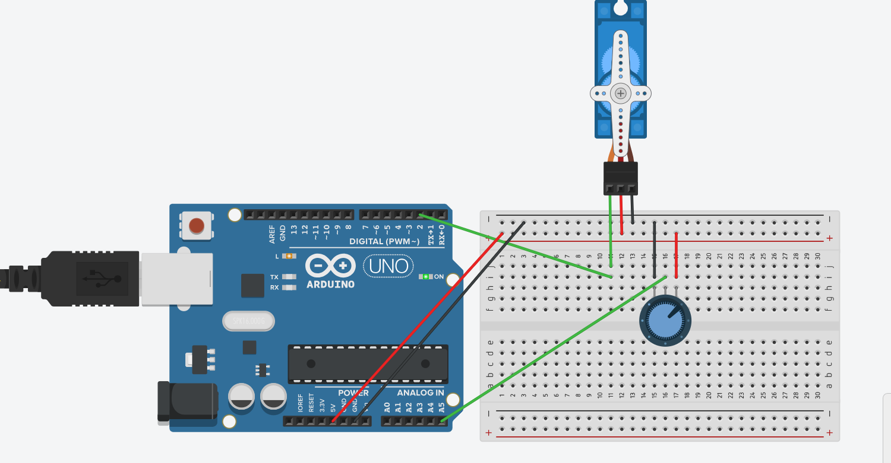

# 02 Building the Circuit - Adding the Potentiometer & Controlling the Servo

Our solar array needs to track the sun smoothly, not just jump back and forth between two positions. To manually control the exact angle of our servo, we are going to add a **Potentiometer** (an analog dial). 

A potentiometer is simply a resistor that can change its resistance when you turn the knob. By reading the voltage that makes it through, our Arduino can tell exactly how far the dial has been turned.

## Wiring the Potentiometer

Leave your servo wired exactly as it is (powered by the rails, signal to Pin 2). Now let's add the dial:

1. **Place the Dial:** Push the potentiometer into the breadboard so its three pins are in three separate, adjacent rows (for example, rows 15, 16, and 17).
2. **Connect Power:** Run a wire from the top pin's row to the `+` 5V rail.
3. **Connect Ground:** Run a wire from the bottom pin's row to the `-` GND rail.
4. **Connect the Signal:** Run a wire (e.g., green) from the **middle** pin's row to Arduino Analog Pin `A5`. This middle pin is the "wiper" that outputs the changing voltage.

*(Refer to your `ACTIVITY-2-TASK-3.png` diagram to ensure your wiring is perfectly aligned!)*

## Writing the Control Code

We need to read the dial (which gives us a number from 0 to 1023) and convert it into a pulse width for our servo (ranging from 1000 microseconds for 0 degrees, up to 2000 microseconds for 180 degrees). 

To do this, we will use a handy Arduino math function called `map()`. It automatically scales a number from one range into another!

Copy this code and **fill in the blanks (`___`)**:

```cpp
// 02: Potentiometer Servo Control

int servoPin = 2;
// Define the analog pin for our dial
int potPin = ___; 

void setup() {
  pinMode(servoPin, OUTPUT);
}

void loop() {
  // 1. Read the dial's position (gives a value from 0 to 1023)
  int potValue = analogRead(______);

  // 2. Convert the dial reading into a pulse width!
  // map(value, fromLow, fromHigh, toLow, toHigh)
  // We map the 0-1023 dial range to a 1000-2000 microsecond pulse range.
  int pulseWidth = map(potValue, 0, 1023, 1000, ____);

  // 3. Send the custom pulse to the servo
  digitalWrite(servoPin, HIGH);
  
  // Keep the power on for the exact number of microseconds we just calculated
  delayMicroseconds(__________); 
  
  digitalWrite(servoPin, LOW);

  // 4. Finish the 20-millisecond PWM cycle before looping again
  delay(20); 
}
